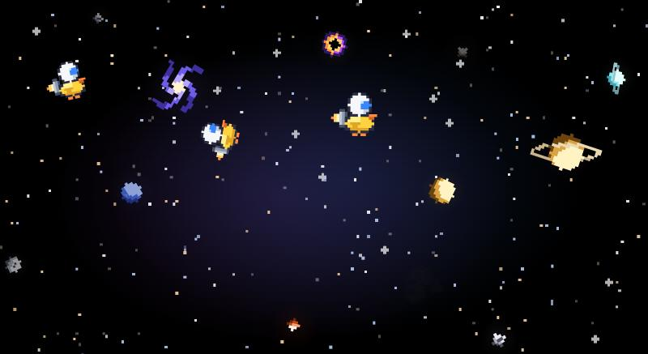

# astroduck

A black theme for the Claude desktop app, as a mod, with an animated pixel sky behind the conversation: the eight planets of the solar system, random planets and moons, galaxies, black holes, and astroducks in helmets with jetpacks. Every session draws a new random sky.



## Install

In Claude Code, add this repository as a marketplace, then install the plugin from it:

```
/plugin marketplace add AyushChaurasia18/astroduck
/plugin install astroduck@astroduck
```

In the Claude desktop app, you can also open *Settings > Plugins*, add the marketplace `AyushChaurasia18/astroduck` with **Add**, then install **astroduck**.

## Use

```
/astroduck less | normal | more          fewer or more objects (normal is the default)
/astroduck animated on | animated off    the objects drift in and out, or stand still (on is the default)
/astroduck bounce on | bounce off        a few objects float the whole time and bounce off the edges
/astroduck off                           back to the app's own look, for this session
```

The choice is kept for the next sessions.

| | less | normal | more |
| --- | --- | --- | --- |
| drifting: most on screen at once | 10 | 20 | 30 |
| bouncing: objects on screen | 6 | 10 | 15 |

Background stars don't count.

## Notes

* The look shows in the desktop and mobile apps. astroduck is a dark theme.
* Only one theme can be active. Turn off other theme plugins first.
* While drifting, at least two astroducks are on screen at any time. While bouncing, ducks fly faster and turn to face the way they go.
* With reduced motion turned on in your system or the app, or with no GPU, the sky stands still.

## Files

* `.claude-plugin/`: `plugin.json` and `marketplace.json`.
* `hooks/register.tsx`: the colors, the backdrop and the `/astroduck` command.
* `hooks/scene.ts`: the sky, drawn as one SVG.
* `hooks/make-colors.js`: the design system's helper. Don't edit it.

## License

MIT. See [LICENSE](./LICENSE).
